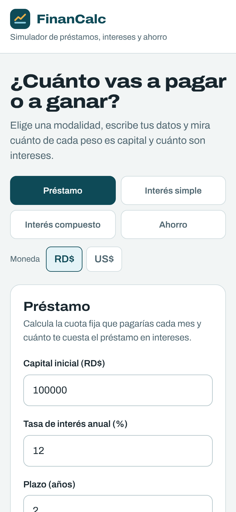
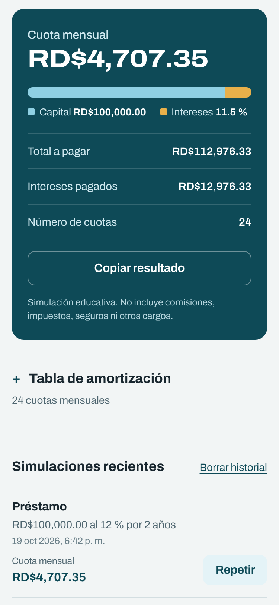
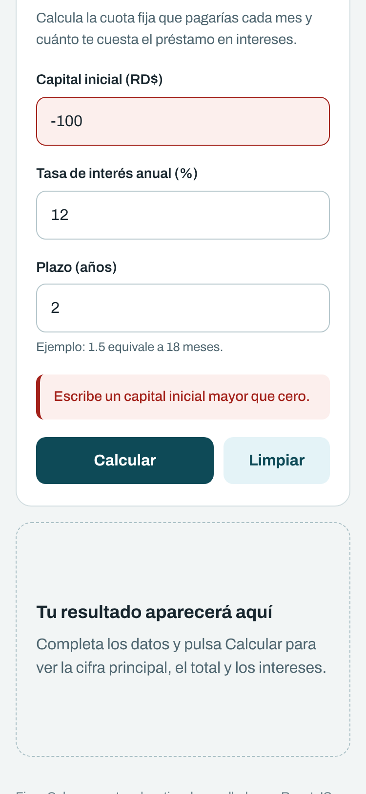
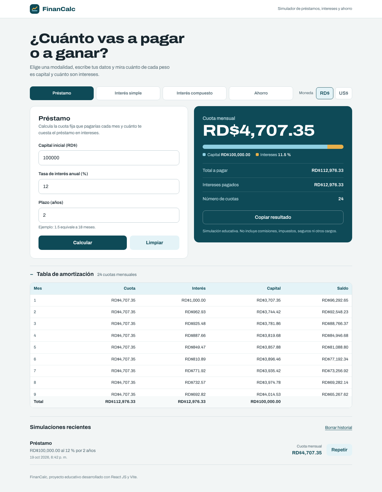

# FinanCalc: calculadora financiera en React

Aplicación web **mobile first** para simular cuotas de préstamos, interés simple, interés compuesto y ahorro, con importes en pesos dominicanos (RD$) o dólares (US$). Es mi versión del proyecto de la *Guía paso a paso FinanCalc React*: sigue su arquitectura (componentes, Hooks, props y fórmulas separadas) y agrega varias de las actividades de ampliación.

**Autor:** Harold Bautista Capellán

**Stack:** React 19, Vite 8, JavaScript y CSS sin librerías de interfaz. Pruebas con Vitest y Testing Library.

## Capturas

### Vista móvil (375 px)

| Pantalla inicial | Resultado de un préstamo | Validación |
| :---: | :---: | :---: |
|  |  |  |

### Vista de escritorio (1280 px)

Préstamo con la tabla de amortización abierta:



Ahorro con aporte mensual:


## Funcionalidades

Requisitos de la guía:

- Elegir la modalidad con pestañas: préstamo, interés simple, interés compuesto y ahorro.
- Ingresar capital inicial, tasa anual y plazo en años.
- Mostrar el resultado principal, el monto total y los intereses.
- Validar las entradas con mensajes claros en español; el campo con error se marca en rojo.
- Botón **Limpiar** para restablecer el formulario.
- Importes formateados en RD$ con `Intl.NumberFormat`.
- La página no se recarga al calcular, todos los campos tienen etiqueta y funcionan con teclado, y la interfaz se usa sin desplazamiento horizontal desde 320 px.

Actividades de ampliación que agregué (sección 12 de la guía):

| Actividad | Nivel | Dónde está |
| --- | --- | --- |
| Cambiar el texto y el ícono del encabezado | Básico | `Header.jsx` (ícono SVG propio) |
| Botón **Copiar resultado** | Básico | `ResultCard.jsx` |
| Elegir RD$ o US$ para el formato | Intermedio | `CurrencyToggle.jsx` |
| Depósitos mensuales en el ahorro | Intermedio | `finance.js` y `CalculatorForm.jsx` |
| Historial con `localStorage` y `useEffect` | Intermedio | `utils/history.js` y `HistoryList.jsx` |
| Tabla de amortización con un componente y `.map()` | Avanzado | `AmortizationTable.jsx` |
| Gráfico de capital vs. intereses | Avanzado | `CompositionBar.jsx` (solo CSS) |

## Instalación y uso

Requisitos: [Node.js](https://nodejs.org/) 22.12 o superior y npm.

```bash
git clone <url-de-este-repositorio>
cd financalc
npm install
npm run dev
```

Abre la dirección que muestra Vite (normalmente http://localhost:5173). Con `server.host` activado en `vite.config.js` también se puede abrir desde el celular, en la misma red Wi-Fi, usando la dirección *Network*.

Otros comandos:

```bash
npm test          # ejecuta las pruebas una vez
npm run lint      # revisa el código con oxlint
npm run build     # genera la versión de producción en dist/
npm run preview   # sirve la versión de producción
```

## Estructura del proyecto

```
src/
  main.jsx                    # Punto de entrada
  App.jsx                     # Estado y coordinación (componente padre)
  styles.css                  # Diseño mobile first
  components/
    Header.jsx                # Encabezado con ícono propio
    CalculatorTabs.jsx        # Selector de modalidad
    CurrencyToggle.jsx        # Selector RD$ / US$
    CalculatorForm.jsx        # Formulario
    NumberField.jsx           # Campo numérico reutilizable
    ResultCard.jsx            # Resultados y botón Copiar
    CompositionBar.jsx        # Gráfico capital vs. intereses
    AmortizationTable.jsx     # Tabla de amortización del préstamo
    HistoryList.jsx           # Simulaciones recientes
  utils/
    finance.js                # Fórmulas, validación y formato de moneda
    modes.js                  # Lista de modalidades
    history.js                # Lectura y escritura en localStorage
  utils/finance.test.js       # Pruebas de las fórmulas
  App.test.jsx                # Pruebas de la interfaz
```

Cada componente resuelve una sola tarea. Las fórmulas viven en `utils/finance.js`, que no importa React.

## Fórmulas

La tasa se escribe como porcentaje **anual nominal** (12 significa 12 %) y se divide entre 100. El plazo está en años.

| Modalidad | Fórmula |
| --- | --- |
| Interés simple | `I = P × r × t`, total `= P + I` |
| Interés compuesto (mensual) | `A = P × (1 + r/12)^(12t)` |
| Préstamo (cuotas iguales) | `C = P × i / [1 − (1 + i)^(−n)]`, con `i = r/12` y `n = meses`; si `i = 0`, `C = P / n` |
| Ahorro con aportes | `A = P(1 + i)^n + D × [((1 + i)^n − 1) / i]`, con aportes `D` al final de cada mes; si `i = 0`, `A = P + D × n` |

En el préstamo y el ahorro el plazo se redondea a meses enteros, porque las cuotas y los aportes son mensuales. Sin aporte mensual, el ahorro da el mismo resultado que el interés compuesto, como en la versión original de la guía.

> Son simulaciones educativas: no incluyen comisiones, impuestos, seguros ni cambios de tasa.

## Explicación de dos componentes

### `NumberField.jsx`: un campo reutilizable y controlado

Es un componente pequeño que se usa cuatro veces (capital, tasa, plazo y aporte). Recibe todo por **props**: `id`, `label`, `value`, `onChange`, `hint` e `invalid`.

- Es un **input controlado**: su `value` no lo decide el propio input, sino el estado `values` que vive en `App`. Cuando el usuario escribe, el input llama a `onChange(event.target.value)` y el padre actualiza el estado; React vuelve a dibujar el campo con el nuevo valor.
- Une el `<label>` con el `<input>` mediante `htmlFor` e `id`, así al tocar la etiqueta se enfoca el campo y los lectores de pantalla lo anuncian.
- Si `invalid` es verdadero, agrega `aria-invalid` y `aria-describedby` apuntando al mensaje de error, y el CSS lo pinta en rojo.
- Usa `inputMode="decimal"` para que en el celular aparezca el teclado numérico.

Gracias a las props, el mismo componente sirve para cualquier dato numérico sin repetir código.

### `ResultCard.jsx`: mostrar el resultado

Recibe `result`, `modeLabel` y `currency` desde `App`.

- **Renderizado condicional:** si `result` es `null`, muestra el mensaje "Tu resultado aparecerá aquí"; si hay resultado, muestra la cifra principal, el gráfico `CompositionBar`, el monto total y los intereses.
- Tiene su propio **estado** `copyStatus` (`useState`) para el botón *Copiar resultado*: al copiar cambia a "Resultado copiado" y un **`useEffect`** con `setTimeout` lo devuelve a su texto original a los 2 segundos. La función de limpieza (`clearTimeout`) evita que el temporizador siga activo si el componente cambia antes.
- Otro `useEffect` con `useRef` desplaza la pantalla hasta el resultado en celulares, donde queda debajo del formulario.
- Usa `aria-live="polite"` para que los lectores de pantalla anuncien el resultado nuevo, y `money()` de `finance.js` para convertir los números en texto con formato de moneda.

ResultCard no calcula nada: solo presenta lo que `App` le entrega.

## Demostración de un cálculo

**Préstamo de RD$100,000 al 12 % anual por 2 años** (los valores que trae el formulario por defecto):

1. Tasa mensual: `i = 0.12 / 12 = 0.01`
2. Número de cuotas: `n = 2 × 12 = 24`
3. `(1 + 0.01)^(−24) = 0.787566`
4. Cuota: `C = 100,000 × 0.01 / (1 − 0.787566) = 1,000 / 0.212434 =` **RD$4,707.35**
5. Total a pagar: `4,707.35 × 24 =` **RD$112,976.33**
6. Intereses pagados: `112,976.33 − 100,000 =` **RD$12,976.33** (11.5 % del total)

Recorrido dentro de la app:

1. El usuario escribe en un `NumberField`; su `onChange` avisa a `CalculatorForm`, que llama a `onFieldChange`.
2. `App` actualiza `values` con `setValues(prev => ({ ...prev, [field]: value }))`.
3. Al pulsar **Calcular**, `submit` ejecuta `event.preventDefault()` para que la página no se recargue.
4. `calculate()` valida los datos y devuelve el objeto de resultado.
5. `App` guarda el resultado con `setResult`, agrega la simulación al historial y React muestra `ResultCard` y la tabla de amortización.

## Demostración de una validación

**Capital = −100, tasa = 12, plazo = 2** (captura *Validación* de arriba):

1. `submit` llama a `calculate()`, que dentro de `parseInputs()` detecta que el capital no es mayor que cero.
2. Lanza un `ValidationError` con el mensaje *"Escribe un capital inicial mayor que cero."* y el nombre del campo (`field: 'principal'`).
3. El `catch` de `submit` guarda `error` y `errorField` en el estado y deja `result` en `null`.
4. El formulario muestra el mensaje con `role="alert"` y el campo *Capital inicial* se marca en rojo con `aria-invalid="true"`.
5. Al corregir cualquier campo, `changeField` limpia el error.

El formulario usa `noValidate` para desactivar los globos de error del navegador. Así siempre se ven los mensajes propios, iguales en todos los navegadores.

## Pruebas

```bash
npm test
```

32 pruebas automáticas: 21 de fórmulas, validaciones y formato (`src/utils/finance.test.js`) y 11 de la interfaz (`src/App.test.jsx`). Incluyen todos los casos de la tabla de pruebas guiadas:

| Caso | Entrada | Resultado esperado | Resultado obtenido |
| --- | --- | --- | --- |
| Interés simple | P=1000, r=12 %, t=2 | Interés RD$240; total RD$1,240 | ✅ RD$240.00 y RD$1,240.00 |
| Compuesto | P=1000, r=0 %, t=2 | Total RD$1,000 | ✅ RD$1,000.00 |
| Préstamo | P=1200, r=0 %, t=1 | Cuota RD$100 | ✅ RD$100.00 |
| Validación | P=−100, r=12 %, t=2 | Mostrar error | ✅ "Escribe un capital inicial mayor que cero." |
| Limpiar | Cambiar valores y limpiar | Restablecer campos | ✅ Vuelven a 100000, 12 y 2 |

## Preguntas de reflexión

**¿Por qué `result` empieza en `null`?**
Porque al abrir la app todavía no hay ninguna simulación. `null` significa "sin resultado" y permite el renderizado condicional: `ResultCard` muestra el mensaje inicial en lugar de cifras vacías o `NaN`. Por la misma razón, cada vez que cambia un campo `result` vuelve a `null`, para no mostrar un resultado que ya no corresponde a los datos.

**¿Qué diferencia existe entre una prop y un estado?**
El estado son datos que un componente posee y puede cambiar con su función `set...`; al cambiar, React vuelve a renderizar. Las props son datos que el padre le pasa al hijo, y el hijo solo las lee. En FinanCalc, `values` es estado de `App` y llega a `CalculatorForm` como prop; el formulario no lo modifica directamente, sino que llama a la función `onFieldChange` que también recibió por props.

**¿Por qué `event.preventDefault()` es importante?**
Porque el comportamiento normal de un formulario al enviarse es recargar la página o navegar a otra dirección. Eso borraría todo el estado de React (los valores, el resultado y el error). `preventDefault()` detiene ese comportamiento y deja que React maneje el cálculo en la misma página, como pide el criterio de aceptación.

**¿Qué sucede si cambiamos el estado directamente?**
Si se hace `values.principal = '5000'`, React no se entera del cambio y no vuelve a renderizar, así que la pantalla queda desactualizada. Además, React compara por referencia: si se pasa el mismo objeto modificado a `setValues`, puede ignorar la actualización. Por eso siempre se crea un objeto nuevo con el operador spread: `{ ...prev, [field]: value }`.

**¿Por qué `finance.js` no importa React?**
Porque solo contiene matemática: recibe números y devuelve resultados, sin nada de interfaz. Así queda separado de la presentación, se puede probar con Vitest sin abrir un navegador y se podría reutilizar en otro proyecto (por ejemplo, una app móvil o un servidor) sin cambios.

## Decisiones propias

- **Validación con mensajes por campo:** `finance.js` indica qué campo falló, para marcarlo en rojo y describirlo a los lectores de pantalla.
- **Fuente local:** la tipografía Archivo se instala con npm (`@fontsource-variable/archivo`), así la app se ve igual sin conexión. Se usa su eje de ancho para que la cifra principal destaque.
- **Paleta propia:** azul profundo y larimar (la piedra dominicana) para el capital, y dorado para los intereses.
- **Accesibilidad:** foco visible con teclado, botones de al menos 40 px de alto, `aria-pressed` en las pestañas, `aria-live` en el resultado y respeto a la preferencia de reducir animaciones.
- **El historial no falla si `localStorage` no está disponible** (por ejemplo, en modo privado): las lecturas y escrituras están dentro de `try/catch`.

## Lista de entrega

- [x] Proyecto ejecutable (`npm install` y `npm run dev`)
- [x] README
- [x] Capturas de vista móvil y escritorio
- [x] Explicación de dos componentes
- [x] Demostración de un cálculo y una validación
